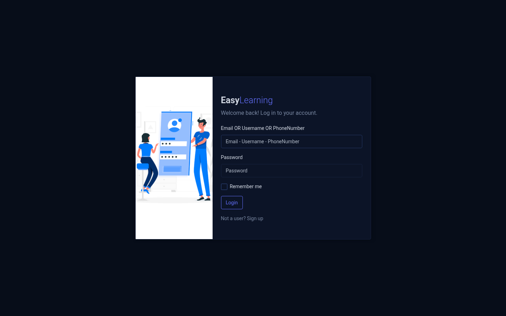
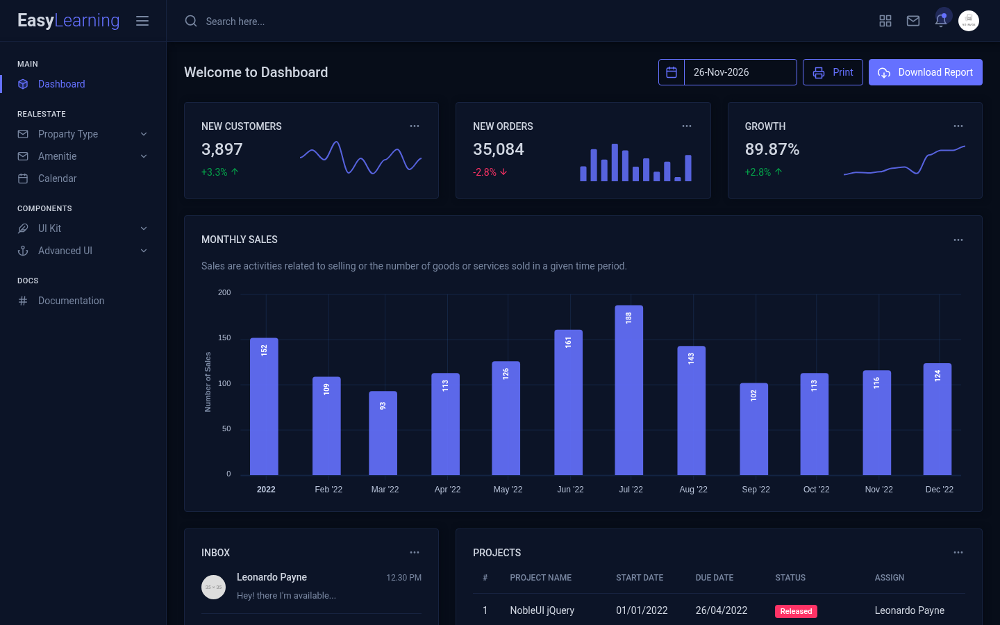
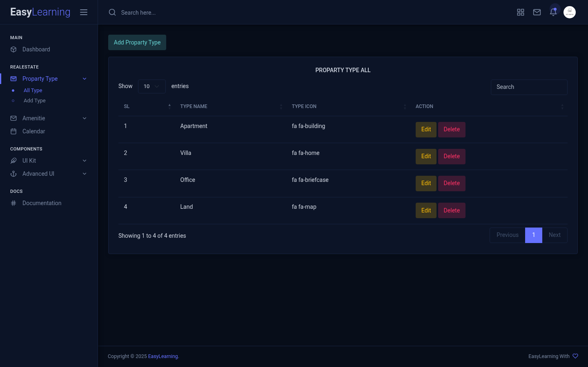

# Real Estate Admin Dashboard

A **Laravel 10** admin dashboard for a real estate site, with role-based access for **admin**, **agent** and **user**.

## 📸 Screenshots

### Admin login


### Admin dashboard


### Property types management


## ✅ What is done

- Authentication with Laravel Breeze and Sanctum — login with email, username or phone number
- Role middleware: separate admin and agent areas
- Admin profile management (view, update, change password)
- Property types CRUD and amenities CRUD
- Seeded demo users for each role

## 🛠️ Tech stack

PHP 8.1, Laravel 10, Blade, Bootstrap 5 (NobleUI admin template), Pest.

## 🚀 Setup

```bash
composer install
cp .env.example .env
php artisan key:generate
# configure your DB_* settings in .env, then:
php artisan migrate --seed
php artisan serve
```

Seeded demo logins:

| Role | Email | Password |
|---|---|---|
| Admin | admin@gmail.com | admin |
| Agent | agent@gmail.com | agent |
| User | user@gmail.com | user |

## 🗺️ Roadmap (edit freely)

- [ ] Properties CRUD (listings, images, price, location)
- [ ] Agent dashboard
- [ ] Public listing pages with search and filters
- [ ] Realistic demo data (factories and seeders beyond users)
